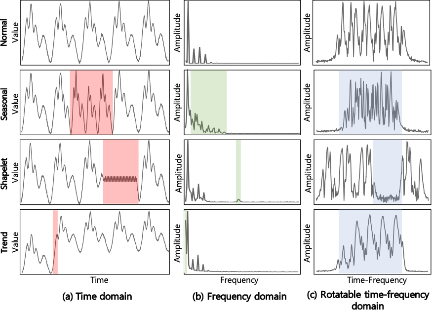
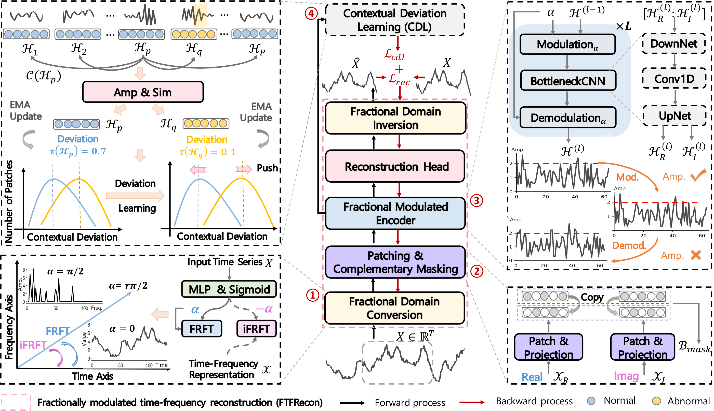
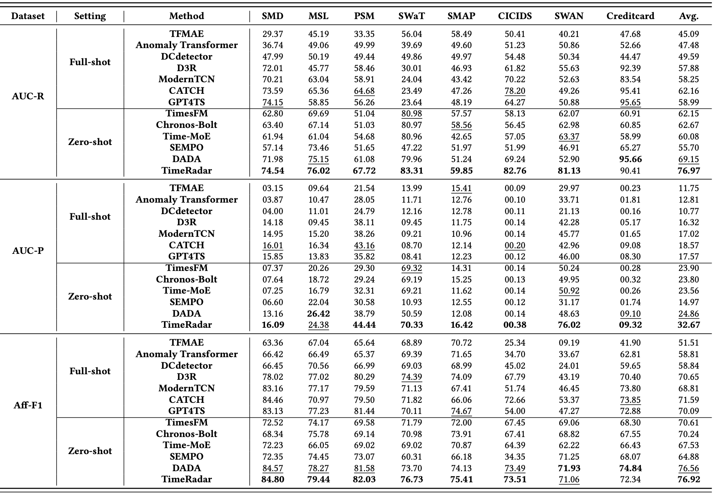
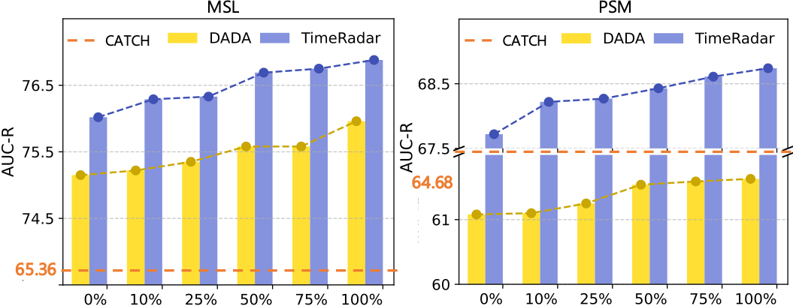
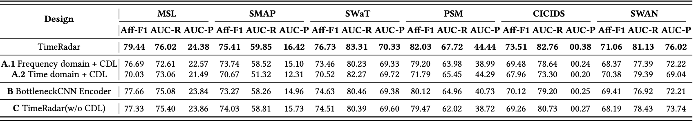

# TimeRadar：可旋转时频域的时间序列异常检测基础模型

**论文名称：** TimeRadar: A Domain-Rotatable Foundation Model for Time Series Anomaly Detection  
**作者：** Hui He、Hezhe Qiao、Yutong Chen、Kun Yi、Guansong Pang  
**时间：** 2026 年（arXiv:2602.19068；官方项目标注 KDD 2026）  
**论文原文：** https://arxiv.org/html/2602.19068v1  
**官方代码：** https://github.com/mala-lab/TimeRadar

> **核心结论：** TimeRadar 的关键贡献是把「在哪个时频表示空间学习」也变成可训练的问题。通过输入相关的分数阶傅里叶变换选择合适的时频表示，再结合重建和局部上下文偏差学习，提高跨数据集异常检测能力。

## 一、研究背景：为什么提出 TimeRadar？

### 1. 传统异常检测模型泛化能力有限

许多深度学习时间序列异常检测方法需要在特定数据集上单独训练，数据域、周期性或异常模式变化后容易出现性能下降。时间序列基础模型可以通过跨领域预训练缓解这一问题，但多数基础模型主要为预测等任务学习普遍规律，而异常检测关注的是稀少、多样且不规则的异常模式，两者目标并不完全一致。

### 2. 固定时域或频域不适合所有异常

不同异常在时域和频域中的显著程度不同：

- **时域：** 局部形状（Shapelet）异常可能较明显，但周期或趋势变化可能与正常波动相似。
- **频域：** 周期或趋势变化可能更突出，但局部异常的特征与发生位置可能被弱化。
- **固定时频融合：** 结合两种特征，却未必能针对不同输入找到最有辨别力的表示角度。

*图 1：论文研究动机。不同异常在固定时域、频域里的可分性并不相同；在可旋转的时频表示中，三类异常都有机会表现出更显著的偏离。来源：作者官方图片。*

**作者的思路：** 不预先固定时域或频域，而是让模型根据当前时间序列学习适合的时频旋转角度，使正常和异常模式更容易区分。

## 二、论文的主要贡献

1. **提出领域可旋转的异常检测基础模型 TimeRadar。** 将可学习、依赖输入的连续时频表示引入跨数据集时间序列异常检测。
2. **设计 FTFRecon。** 通过可学习的分数阶傅里叶变换（FRFT），在更合适的时频域中进行 Patch 建模与序列重建；编码阶段引入分数阶调制来改善局部相位对齐。
3. **设计 CDL。** 对局部 Patch 相对于周围上下文的偏差进行建模，用辅助损失拉开正常与异常样本的特征差异，弥补整体重建对部分局部异常不敏感的问题。
4. **验证跨域能力。** 在八个时间序列异常检测基准上测试 Zero-shot 表现，并通过 Few-shot 和消融实验验证方法效果。

## 三、方法：TimeRadar 是怎么工作的？

### 1. 总体架构

*图 2：FTFRecon（分数阶时频重建）与 CDL（上下文偏差学习）的配合关系。来源：作者官方图片。*

FTFRecon 的主流程为：

**原始序列 → 分数阶时频转换 → Patch 划分和互补掩码 → 分数阶调制编码器 → 重建头 → 逆变换回时域**。

CDL 则在编码后的局部表示上构建辅助约束，和重建损失一起参与预训练。

### 2. FTFRecon：自适应时频转换和重建

#### （1）学习时频旋转角度

普通傅里叶变换相当于从时域走向频域。分数阶傅里叶变换（Fractional Fourier Transform, FRFT）允许在连续的时频表示空间中旋转。

TimeRadar 通过输入序列预测分数阶参数，而不是人工指定角度：

$$
r=\operatorname{Sigmoid}(\operatorname{MLP}(X)),\qquad
\alpha=\frac{r\pi}{2}
$$

- $r$ 接近 0：表示更接近时域。
- $r$ 接近 1：表示更接近频域。
- 中间取值：对应不同的分数阶时频表示。

这样，不同输入数据可以拥有不同的旋转角度。**创新点不是简单拼接时域特征与频域特征，而是让表示域本身可学习、可适配。**

#### （2）Patch 和互补掩码

FRFT 之后得到复数表示，包含实部和虚部。模型对两个部分做 Patch 划分和特征投影，并共享互补掩码策略，以保持两部分的相位对应关系。

掩码重建迫使模型借助上下文恢复被遮挡内容，从而学习跨 Patch 的规律，而不是简单复制输入。

#### （3）分数阶调制编码器

编码器使用 FracBlock，主要包括：

**Modulation（相位调制）→ BottleneckCNN（局部卷积建模）→ Demodulation（相位解调）**。

调制与解调用于缓解 Patch 之间的相位不一致，使卷积网络更适合学习旋转时频域的局部特征。最后由复数重建头恢复时频表示，再通过逆 FRFT 返回时域。

### 3. CDL：补充局部异常识别

只有全局重建时，一些局部片段虽然能被重建，却与周围时间片段的规律不协调，仍然可能成为漏检异常。

CDL 通过余弦相似度衡量一个 Patch 与同一窗口内其他 Patch 的差异，将其作为上下文偏差，并利用基于 Margin 的辅助损失优化正常和异常片段的可分性。训练时还使用 EMA 更新上下文偏差的统计量。

总损失：

$$
\mathcal{L}_{\mathrm{pretrain}}=
\mathcal{L}_{\mathrm{rec}}+
\lambda\mathcal{L}_{\mathrm{cdl}}
$$

这里 $\mathcal{L}_{\mathrm{rec}}$ 是重建损失，$\mathcal{L}_{\mathrm{cdl}}$ 是上下文偏差损失；论文默认 $\lambda=0.1$。

**两者互补：FTFRecon 学习整体可重建的规律，CDL 在特征层面增强局部异常的辨别能力。** 需要说明的是，CDL 的正常/异常 Patch 监督来源于带人工注入异常的预训练数据，并非全程无标签学习。

### 4. 推理：如何得到异常分数？

推理时同时使用平均重建误差和多次重建的方差：

$$
S(X_t)=
\operatorname{Var}_{W}(\hat X_t)+
\left\|X_t-\operatorname{Mean}_{W}(\hat X_t)\right\|_2^2
$$

即 **异常分数 = 重建不确定性 + 重建误差**。难以稳定重建的点可能得到更高分数。对于需要二值检测结果的评价，论文采用 SPOT 选取阈值。

## 四、实验设计和结果

### 1. 实验设置

- **预训练：** Monash+，约 4.08 亿个时间点，正常序列来自 Monash 数据，异常样本通过人工注入构造；预训练数据不包含下游测试数据集。
- **八个主要基准：** SMD、MSL、PSM、SWaT、SMAP、CICIDS、SWAN、Creditcard。
- **基线：** DADA、TimesFM、Chronos-Bolt、Time-MoE、SEMPO，以及 CATCH、ModernTCN 等传统检测模型。
- **指标：** AUC-R、AUC-P、Aff-F1；论文未采用可能使结果过于乐观的 Point Adjustment（PA）。
- **对比条件：** 基础模型使用 Zero-shot；不支持直接零样本迁移的部分传统方法按照 Full-shot 训练后评估。两类结果应区分理解。

### 2. Zero-shot：跨数据集能不能检测？

*表 1：论文完整主实验表，按 AUC-R、AUC-P 和 Aff-F1 比较多种方法。来源：作者官方图片。*

以下摘录八个基准的**平均值**（单位：%，越高越好）：

| 方法 | 评估设置 | AUC-R | AUC-P | Aff-F1 |
|---|---|---:|---:|---:|
| CATCH | Full-shot | 62.16 | 18.57 | 71.59 |
| TimesFM | Zero-shot | 62.15 | 23.90 | 70.61 |
| Chronos-Bolt | Zero-shot | 62.67 | 23.80 | 70.24 |
| DADA | Zero-shot | 69.15 | 24.86 | 76.56 |
| **TimeRadar** | **Zero-shot** | **76.97** | **32.67** | **76.92** |

与异常检测基础模型 DADA 相比：

- **AUC-R：** 69.15 → 76.97，增加 **7.82 个百分点**。
- **AUC-P：** 24.86 → 32.67，增加 **7.81 个百分点**。
- **Aff-F1：** 76.56 → 76.92，增加 **0.36 个百分点**。

论文摘要还报告平均 AUC-R、AUC-P 提升 10.5%、29.4%（为作者所报告的平均相对提升口径，不等同于直接比较上述平均值所得的百分比）。

**结果分析：** TimeRadar 在跨数据集排序指标上优势明显，但 Aff-F1 增益较小，也不是所有单个数据集、单项指标都领先。例如 Creditcard 的 AUC-R 低于 DADA，MSL 的 AUC-P 也略低于 DADA。因此适合将结论表述为**整体跨域检测性能较好**，而不是所有异常类型均占优。

### 3. Few-shot：少量目标数据能否继续适配？

*图 3：不同目标训练数据比例下，TimeRadar 与 DADA 的 AUC-R 表现，并以 CATCH 的 Full-shot 结果作参考。来源：作者官方图片。*

Few-shot 实验在 MSL 和 PSM 上开展，冻结预训练主干，仅微调重建头（Head Probing）。

从图中可以看到：

1. 随着目标数据增加，TimeRadar 和 DADA 的性能都有提升。
2. 在所测试的数据比例下，TimeRadar 均优于 DADA。
3. TimeRadar 在少量数据下仍保持一定优势，说明预训练表示具有可迁移性。

### 4. 消融：到底哪些模块发挥了作用？

*表 2：完整消融结果，覆盖 MSL、SMAP、SWaT、PSM、CICIDS、SWAN。来源：作者官方图片。*

摘录三项代表性指标（越高越好）：

| 模型版本 | MSL Aff-F1 | SWaT Aff-F1 | PSM AUC-P |
|---|---:|---:|---:|
| **完整 TimeRadar** | **79.44** | **76.73** | **44.44** |
| 固定频域 + CDL | 76.69 | 73.46 | 38.99 |
| 固定时域 + CDL | 70.03 | 70.52 | 44.29 |
| 去掉分数阶调制 | 77.66 | 74.63 | 40.73 |
| 去掉 CDL | 77.33 | 74.51 | 38.72 |

**三点结论：**

- **自适应时频域有效：** 将连续可学习的 FRFT 替换成固定时域或频域，代表性指标下降，说明收益不只是“多用了频域特征”。
- **CDL 有效：** 去掉 CDL 后，PSM 的 AUC-P 从 44.44 降到 38.72，表明局部上下文偏差学习提供了补充信息。
- **分数阶调制有效：** 去掉相位调制与解调后，多项指标下降，支持跨 Patch 相位处理的必要性。

论文还比较了人工网格搜索的固定旋转角度与学习得到的角度：不同数据集的较优角度不一致，学习角度能够接近网格搜索最优值，进一步说明固定一个旋转角度并不理想。

### 5. 模型规模与效率

论文给出的模型参数量为：

| 模型 | 参数量 |
|---|---:|
| TimeRadar | **1.6M** |
| DADA | 1.8M |
| Chronos-Bolt | 205M |
| TimesFM | 500M |

默认输入窗口长度为 100，Patch 长度为 5。作者报告，在两张 Pro6000 96GB GPU 上，预训练约耗时 3 小时。

在论文的 PSM 推理实验中，TimeRadar 相比 DADA、Chronos-Bolt 和 TimesFM 具有更快的推理速度；但其参数量与延迟仍高于部分传统检测模型。因此模型的价值更接近**泛化性能与推理成本之间的折中**，而非绝对最轻量。

## 五、总结与思考

### 1. 最核心的创新是什么？

**TimeRadar 将「时间序列在哪个域表示」变成可学习的问题。** 与固定时域、频域或简单融合相比，利用输入相关 FRFT 学习旋转角度，使不同异常模式在更合适的表示空间里突出；再配合分数阶调制重建与 CDL 局部偏差约束，提高异常检测的可分性。

### 2. 实验支持什么结论？

跨八个数据集的 Zero-shot 评估显示，TimeRadar 的平均 AUC-R 和 AUC-P 明显优于相关基线；Few-shot 与消融实验也支持可学习旋转和 CDL 的作用。但需要留意不同指标的提升幅度存在差异，且并非在所有单独数据集上都最优。

### 3. 局限和后续研究方向

**（1）预训练依赖人工合成异常。** 论文通过注入异常构造训练样本，并利用这些标签开展 CDL。真实世界的异常形态未必覆盖在合成分布中，尤其值得研究跨域迁移时的差异。

**（2）变量间依赖建模有限。** 为适应不同维度的目标数据，论文采用 Channel Independence，将多变量序列拆分为单变量序列。这便于泛化，但可能遗漏只表现在多变量关联上的异常。

**（3）真实弱标签场景需要单独验证。** 在实际监测中，异常起点可能未知、标签不完整，采样率、噪声和设备行为也会变化。公开基准上的 Zero-shot 优势不必然等同于真实部署下的早期报警能力。

**（4）可探索的改进思路。** 将可旋转时频表示与多变量关系建模结合；评估弱标签、缺失观测和跨区域泛化；研究连续监测条件下的报警延迟与误报负担。

总之，这篇论文值得关注的不是单独使用 FRFT，而是 **可学习的时频域选择 + 面向异常的重建目标 + 局部上下文偏差约束** 这一组合。

---

## 参考资料

- 论文原文（2026 年 2 月 arXiv 版本）：https://arxiv.org/html/2602.19068v1
- 作者官方代码与配图：https://github.com/mala-lab/TimeRadar
- 本文数值来自论文 Table 1、Table 2 以及正文实验章节；图片来自作者官方仓库 figures 目录，并随本报告存放于 images 文件夹。
